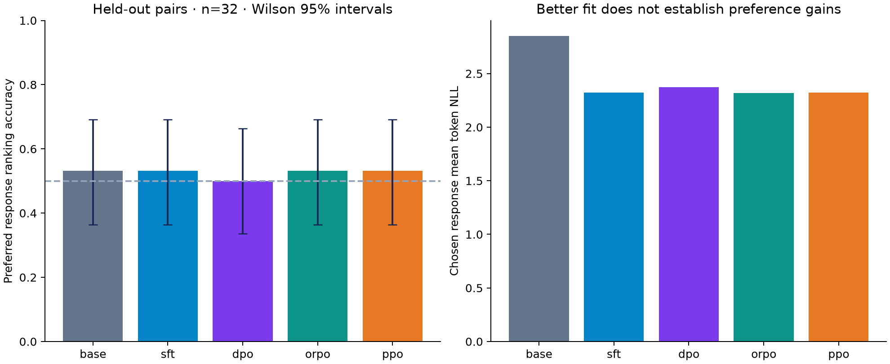
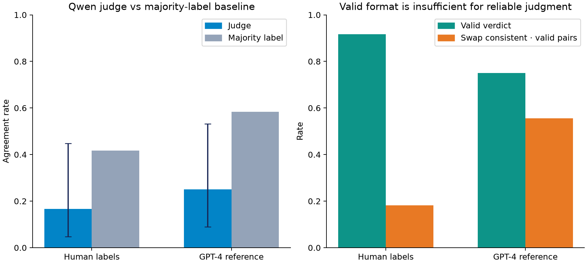

# AccordLens
### Preference Alignment & Judge Reliability

[](https://github.com/Pariamazaheri/accordlens-preference-alignment/actions/workflows/ci.yml)


**A reproducible LLM engineering benchmark for deciding whether adaptation and automated evaluation deserve trust.** AccordLens implements SFT, reward modeling, PPO, DPO, and ORPO on Qwen2.5-0.5B-Instruct, then audits an LLM judge against genuine human annotations and a separate GPT-4 reference.

For customer-support systems, an evaluator that changes its verdict when answers change position can approve the wrong model. This project combines modular training, uncertainty-aware evaluation, portable adapters, and provenance checks to expose that risk before using an automated judge to approve releases. It is an independent portfolio experiment, with a small measured CPU protocol; it is not a deployed customer-support model.

## Executive findings

- **Better language fit does not establish better preferences.** SFT lowers preferred-response token NLL from 2.853 to 2.324, while held-out ranking stays at 53.13%. DPO, ORPO, and PPO show no established ranking gain in this run.
- **The reward model needs scrutiny.** Its 65.63% held-out pairwise accuracy has a 95% interval spanning chance. Validation selects an early checkpoint before the head overfits.
- **The small judge is unsuitable for autonomous release decisions.** Human agreement is 16.7%, below the 41.7% majority-label comparator; swapped answers remain consistent on only 2 of 11 valid pairs.
- **Provenance changes the interpretation.** The provided comparison export contains GPT-4 judgments, not human labels. Public-source verification and separate evaluation prevent that distinction from being lost.




See the [measured benchmark](reports/benchmark.md), [executed notebook](notebooks/decision_audit.ipynb), and [implementation review](docs/quality_review.md).

## Methodology

1. **Source and validate data.** Pinned Anthropic HH-RLHF conversations retain full dialogue histories. Reject malformed pairs and identical responses; exclude 69 exact parsed prompts occurring in both source splits. Stable SHA-256 ordering selects unique, complete native-chat sequences with at most 256 tokens. No response is silently truncated.
2. **Keep evaluation isolated.** Use 48 training pairs, 16 validation pairs from the official training split, and 32 pairs from the official test split. All policy methods share the same held-out examples. Short-sequence eligibility deliberately changes the population; results apply to this subset.
3. **Adapt economically.** Train 270,336 LoRA parameters on query/value projections. SFT learns only response tokens. DPO compares response log-probability sums against a fixed SFT reference. ORPO jointly optimizes response NLL and stable odds-ratio preference loss from the instruction base. Policy stages use fixed 20-update budgets, two examples per update, one seed, and FP32 CPU execution.
4. **Build a reward signal and optimize rollouts.** A linear Bradley–Terry head on frozen SFT representations uses validation-only checkpoint selection. PPO combines a learned token-value critic, GAE, sampled reference-KL reward shaping, fixed rollout probabilities, multiple optimization epochs, and clipped policy/value updates. Train-only statistics normalize rewards. Reward inputs use the same native chat completion format as reward training.
5. **Evaluate separate questions separately.** Report likelihood ranking, token NLL, reward ranking, Wilson intervals, paired bootstrap differences, judge validity/agreement/macro-F1/kappa, and answer-swap consistency. Genuine human judgments and GPT-4 labels are reported separately. Invalid verdicts remain invalid.
6. **Measure bilingual support costs.** Six authored English/Persian retail-support messages compare Llama 2 and Llama 3 tokenizer costs, without their model weights. This is a cost diagnostic, not a claim about answer quality or retail transfer.

The project includes correct implementations and verifiable evidence. Larger datasets, multiple seeds, stronger reward models, representative retail evaluations, and human review remain necessary before deployment. Training objectives and evaluation scores have different meanings and must not be ranked on a shared raw scale.

## Repository layout

```text
configs/        Recorded experiment protocol
src/accordlens/ Reusable objectives, encoding, training, judging, audit, and CLI
scripts/        Asset sourcing, preparation, reporting, and notebook execution
notebooks/      Executed evidence walkthrough
reports/        Row-level evidence, uncertainty, benchmark, and figures
data/           Source profile, split identifiers, and authored bilingual cases
artifacts/      SFT/DPO/ORPO/PPO adapters, reward/value heads, and model card
tests/          Offline mathematical and actual Qwen/PEFT integration tests
docs/           Design decisions, correctness review, and third-party attribution
```

Raw datasets and base weights are downloaded locally and ignored by Git. Every tracked directory contains useful material.

## Installation

Use Python 3.11 or 3.12. A CPU environment is sufficient for the recorded small protocol; allow roughly 6 GB of free memory and several GB of disk for raw text and model weights.

```bash
git clone https://github.com/Pariamazaheri/accordlens-preference-alignment.git
cd accordlens-preference-alignment
python -m venv .venv
source .venv/bin/activate
python -m pip install --upgrade pip
python -m pip install '.[dev]'
```

## Usage

**Verify the released evidence without downloading models or datasets:**

```bash
pytest -q
python scripts/validate_results.py
python scripts/build_report.py
ruff check .
ruff format --check .
```

**Reproduce real-model training and judging:**

```bash
python scripts/download_assets.py --model
python scripts/prepare_local.py   --train data/raw/train.jsonl --test data/raw/test.jsonl   --human data/raw/human.parquet --reference data/raw/gpt4.parquet   --model models/qwen
accordlens train --model models/qwen
accordlens judge --model models/qwen
python scripts/finalize_adapters.py --model models/qwen
python scripts/build_report.py
python scripts/create_notebook.py
python scripts/execute_notebook.py
python scripts/validate_results.py
```

The separate GPT-4 comparator uses the first 1,000 official rows to reproduce the reviewed source export; the human comparator uses the human split. Native model weights and data revisions are pinned; Hugging Face model access may depend on local networking. Training refreshes local adapter metadata; run `finalize_adapters.py` afterward to make the exported adapters portable and verify an independent reload.

**Generate a response using the released DPO adapter:**

```bash
accordlens respond --model models/qwen --adapter artifacts/dpo   --prompt 'Explain a clear and polite product return process.'
```

This is a demonstration, not a validated retail policy engine. The response must be reviewed against the actual merchant's policy.

**Rerun bilingual token costs:** acquire the tokenizer-only assets from [Llama 2](https://huggingface.co/meta-llama/Llama-2-7b-hf) and [Llama 3](https://huggingface.co/meta-llama/Meta-Llama-3-8B-Instruct), subject to their access terms, then run:

```bash
python scripts/tokenizer_audit.py --llama2 /path/to/llama2-tokenizer   --llama3 /path/to/llama3-tokenizer
```

Existing tokenizer results remain available without downloading those assets. The notebook reads the released evidence and runs lightweight objective checks; it does not retrain models during execution. CI checks Python 3.11/3.12, formatting, offline tests, evidence integrity, and wheel packaging.

## Sources and licenses

- [Anthropic HH-RLHF](https://huggingface.co/datasets/Anthropic/hh-rlhf): human preference conversations, MIT.
- [MT-Bench human/GPT-4 judgment splits](https://huggingface.co/datasets/lmsys/mt_bench_human_judgments): CC BY 4.0; labels explicitly distinguished.
- [Qwen2.5-0.5B-Instruct](https://huggingface.co/Qwen/Qwen2.5-0.5B-Instruct): Apache 2.0; base weights excluded, derived adapters attributed.
- [DPO](https://arxiv.org/abs/2305.18290), [PPO](https://arxiv.org/abs/1707.06347), [ORPO](https://arxiv.org/abs/2403.07691), and [LLM-as-a-judge/MT-Bench](https://arxiv.org/abs/2306.05685).

Code is MIT. Derived model artifacts follow the base model's Apache 2.0 terms. Dataset and tokenizer licenses remain separate. See [third-party notices](docs/third_party_notices.md) and the [model card](artifacts/MODEL_CARD.md).

**Author:** [Paria Mazaheri](https://github.com/Pariamazaheri). This portfolio rebuild used AI assistance for review, implementation, testing, and documentation; recorded experiments were executed locally. No client deployments, employment history, or business impact are claimed.
